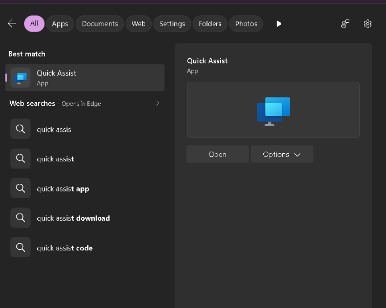
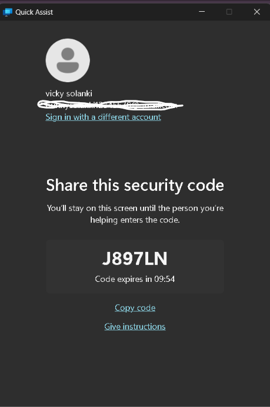
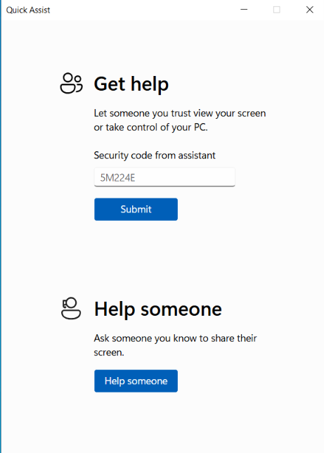
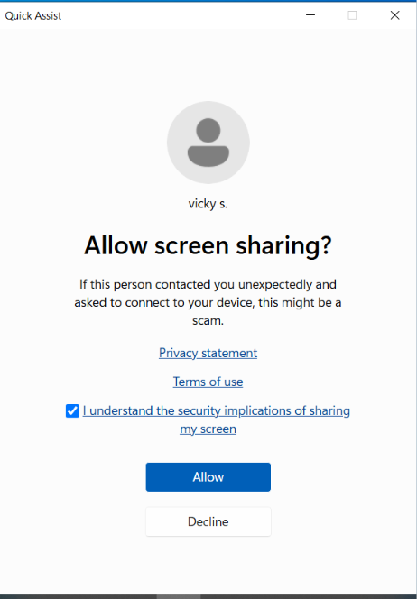
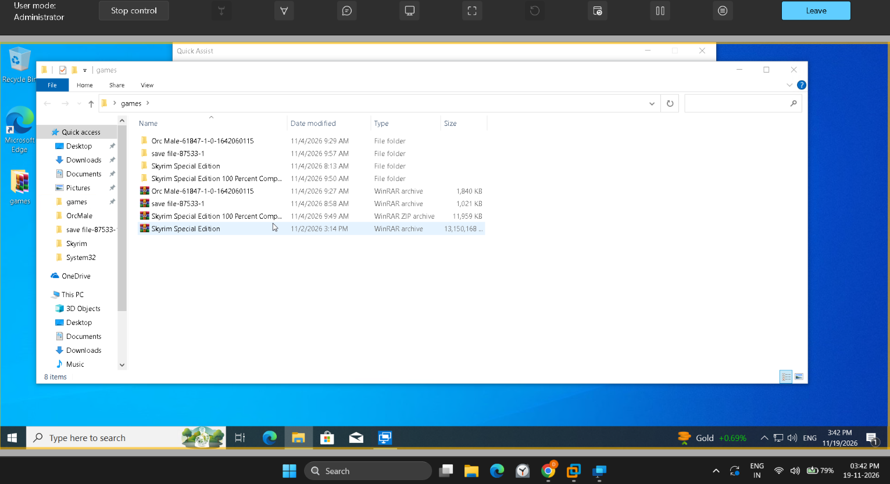
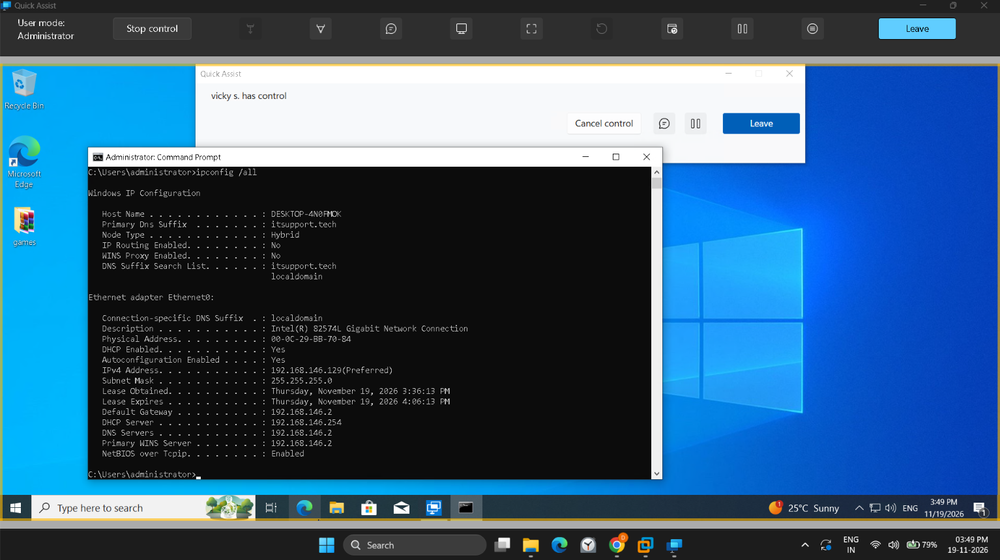

A user calls: *"My Outlook keeps crashing and I have a meeting in ten minutes."*

Ten years ago, you would walk to their desk, or worse, spend 20 minutes asking them to "click the thing in the corner." Today you ask them to press two keys, read you a six-digit code, and you are looking at their screen in under a minute.

That is remote support, and for Windows users the fastest way to start is a tool that is already installed: **Quick Assist**.

This guide covers how Quick Assist works, how I use it on real tickets, and which other remote tools an IT support engineer should know, and when to use each one.

---

## What is Quick Assist?

Quick Assist is Microsoft's built-in remote support app for Windows. One person (the **helper**) connects to another person's PC (the **sharer**) over the internet so they can view the screen or take control and fix the problem.

Why it is useful for support work:

- **Already installed** on Windows 10 and Windows 11, so there is nothing to download in most cases.
- **No VPN or firewall changes**, because it works over a normal internet connection.
- **Code-based and temporary.** The session only exists while both people are connected.
- **User must approve.** The sharer always has to accept the connection.

> **Note:** Quick Assist is built for *attended* support, where the user is sitting at the PC. It is not meant for unattended access to servers or office machines overnight. For that, see the tools section below.



---

## What you need before you start

| Requirement | Helper (you) | Sharer (user) |
|---|---|---|
| Windows 10 / 11 with Quick Assist | Yes | Yes |
| Internet connection | Yes | Yes |
| Microsoft account sign-in | Yes, required | Usually not required |
| Must be present at the PC | Not required | Yes, to approve and watch |

Tip: sign in with the account your organisation allows. Some companies restrict Quick Assist through Intune or Group Policy, so if the app fails to connect, check with your admin team before troubleshooting the network.

---

## Step by step: how to run a Quick Assist session

### Step 1: Helper opens Quick Assist

Press `Win` + `Ctrl` + `Q`, or search for **Quick Assist** in the Start menu. Sign in, then choose **Assist another person**.

You will get a **6-digit security code**. It stays valid for a short time only (about 10 minutes), so make sure the user is ready before you generate it.



### Step 2: User enters the code

On the user's PC, they open Quick Assist the same way and type the code under **Get assistance**.

If they cannot find the app, ask them to press `Win` + `Ctrl` + `Q`. This shortcut works on most up-to-date Windows 11 PCs and is easier than describing menus over the phone.



### Step 3: Choose the access level

The helper picks one of two options:

- **Take full control:** you can use the mouse and keyboard on their PC. Use this to fix things.
- **View screen:** you can only watch. Use this to guide the user or to diagnose without touching anything.

The user then sees a permission prompt and clicks **Allow**.

> **Good habit:** start with *View screen* when the user wants to learn how to do something themselves. Switch to *Full control* only when you actually need to change settings.



### Step 4: Work the problem

Once connected, the toolbar at the top gives you several useful options:

- **Annotate** to draw on the screen and point at something
- **Actual size / Fit screen** to make small text readable
- **Task Manager** to open it quickly on the remote PC
- **Restart** to reboot the remote PC and reconnect automatically in many cases
- **Pause** so the user can do something private without ending the session
- **Device info and Chat** for context and quick messages (depending on the version)



### Step 5: End the session cleanly

Before you disconnect:

1. Ask the user to **confirm the problem is fixed** by reproducing it.
2. Close any admin windows you opened.
3. Make sure you did not leave files or tools on their desktop.
4. Select **End** and tell the user the session is closed.
5. Write the ticket notes while the details are fresh.

---

## Common problems Quick Assist solves

Here are tickets I would happily handle remotely:

- **Application crashes:** Outlook, Teams, Excel, browser add-ins
- **Printer issues:** wrong default printer, stuck queue, driver reinstall
- **Network problems:** Wi-Fi connected but no internet, DNS cache, VPN profile errors
- **Slow PC:** startup apps, disk space, pending updates
- **Account and sign-in issues:** Microsoft 365 sign-in loops, cached credentials
- **Settings and how-to help:** screen sharing, audio devices, default apps

For example, a quick "no internet" check from a remote session is just a few commands:

```powershell
ipconfig /all
ping 8.8.8.8
ping google.com
ipconfig /flushdns
```

If you want the full method, see my post on finding the broken link with four pings: [WiFi Connected but No Internet?](/troubleshooting/2026/10/28/wifi-connected-but-no-internet-find-the-broken-link/)



---

## Limits you should know about

Quick Assist is great, but it is not for everything.

- **UAC and admin prompts.** Elevated prompts can behave differently over remote sessions. If something will not accept your clicks, ask the user to approve it or use a tool built for admin work.
- **Needs a working internet connection.** If the PC has no network at all, Quick Assist cannot connect. Use a phone call and walk the user through the fix, or go on site.
- **Not for unattended access.** The user has to be there.
- **Not for before-login tasks.** If Windows will not boot or the user cannot reach the desktop, you need another approach (see below).
- **Policy restrictions.** Many enterprises block it on purpose and standardise on a managed tool.

---

## Beyond Quick Assist: the remote tools IT engineers actually use

No single tool covers everything. A good support engineer knows which tool fits which situation.

| Tool | Best for | Unattended access | Notes |
|---|---|---|---|
| **Quick Assist** | Fast, one-off help for a user at the PC | No | Built in to Windows, minimal setup |
| **Microsoft Remote Help** | Managed help desk sessions in Intune environments | No | Role-based, with sign-in for both sides, stronger for enterprise |
| **Remote Desktop (RDP)** | Admin work on servers and office PCs | Yes | Needs network access, usually VPN or a gateway |
| **Chrome Remote Desktop** | Personal or small-team access | Yes | Simple, tied to a Google account |
| **AnyDesk / TeamViewer** | Cross-platform support, including mobile | Yes (with setup) | Check company policy before using |
| **ScreenConnect, NinjaOne, Datto and other RMM tools** | Managing hundreds of devices as an MSP or large IT team | Yes | Includes scripting, patching, monitoring and audit logs |
| **SSH** | Linux servers, network devices | Yes | Command line, lightweight and scriptable |
| **PowerShell Remoting** | Running commands across many Windows machines | Yes | Great for automation |

### How I decide which tool to use

1. **User is at the PC and needs help now?** Quick Assist, or Remote Help if your organisation uses it.
2. **Need to work on a server or a PC that nobody is sitting at?** RDP over VPN, or your RMM tool.
3. **Same fix on 50 machines?** PowerShell or your RMM, not 50 separate sessions.
4. **Linux box or network switch?** SSH.
5. **User cannot get online at all?** Phone call, local steps, or an on-site visit.

---

## Security: do not skip this part

Remote access is powerful, so it is also what scammers abuse. Fake "tech support" callers regularly ask people to open Quick Assist and give them control.

### For the user (sharer)

- Only share a code with someone **you contacted or expected** through an official channel.
- Never give a code to a caller who "found a virus" on your PC.
- Never log into your bank or share passwords during a session.
- End the session if anything feels wrong. Closing the app disconnects it.

### For the support engineer (helper)

- **Verify identity first.** Confirm the user is who they say they are, using your ticketing system or a known phone number.
- **Get consent.** Tell the user what you are about to do, especially before opening personal files or browsers.
- **Do not touch what you do not need.** Stay within the scope of the ticket.
- **Never ask for passwords.** If a sign-in is needed, let the user type it. Use *Pause* if necessary.
- **Prefer managed tools** that log who connected, when and to what device.
- **Document everything.** Date, time, device, what you changed and the result.


---

## Remote support etiquette that makes users love you

Technical skill gets the ticket closed. Communication gets you thanked.

- **Start with a plan.** "I'll connect, take a look at the printer settings, and fix the queue. It should take about five minutes."
- **Narrate while you work.** Silence on a remote session makes users nervous.
- **Teach one small thing.** "Next time, you can restart the print spooler like this."
- **Respect privacy.** If an email or private file appears on screen, ignore it and move on.
- **Confirm the fix with the user** before you close the session or the ticket.

---

## A simple remote support checklist

Copy this into your ticket template:

- [ ] Verified user identity
- [ ] User consent obtained
- [ ] Issue described and reproduced
- [ ] Session type (View / Full control) chosen
- [ ] Changes noted in the ticket
- [ ] Fix confirmed by the user
- [ ] Session ended and temporary files removed
- [ ] Follow-up or root-cause note added

---

## Troubleshooting Quick Assist itself

| Symptom | What to try |
|---|---|
| Code is rejected | It may have expired. Generate a new one and enter it again. |
| Cannot sign in as helper | Check your Microsoft account, date and time, and network. |
| App is missing | Install **Quick Assist** from the Microsoft Store, or enable it in Windows optional features if blocked. |
| Connection stuck on "Connecting" | Check internet on both sides, disable VPN or proxy temporarily, and retry. |
| Screen is black or frozen | Ask the user to move the mouse, switch display or restart the session. |
| Control is greyed out | The user may have chosen *View screen*, or policy may block control. |
| Blocked by company policy | Ask your admin about Remote Help or the approved remote tool. |

---

## Final thoughts

Quick Assist will not replace your full toolkit, but for everyday help desk work it is hard to beat: nothing to install, nothing to configure, and a fix in minutes.

The real skill is knowing **when to use it, when to switch tools, and how to keep the user safe while you work.** Master that, and you will resolve more tickets, spend less time travelling to desks and build the trust that makes users call you first.

Have a remote support trick that saves you time? Add it to your own runbook, and if you use a tool I did not cover here, I would love to hear how you use it.

---

### Related posts

- [WiFi Connected but No Internet? Find the Broken Link in 4 Pings](/troubleshooting/2026/10/28/wifi-connected-but-no-internet-find-the-broken-link/)
- [Windows Event Viewer: Find Why Your PC Crashed](/troubleshooting/2026/11/05/windows-event-viewer-find-why-your-pc-crashed/)
- [Printer Not Working? A 10-Minute Remote Fix Checklist](/troubleshooting/2026/11/12/printer-not-working-remote-fix-checklist/)
