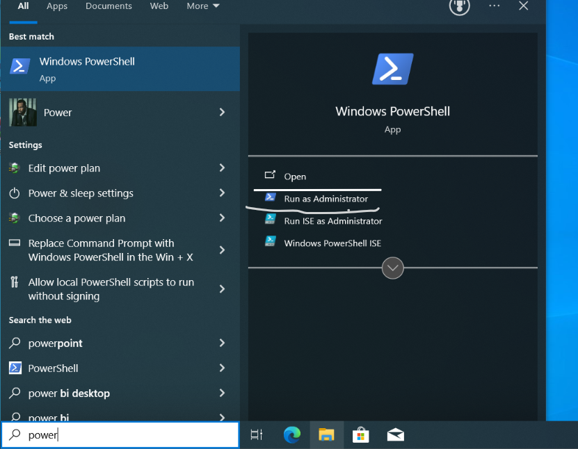
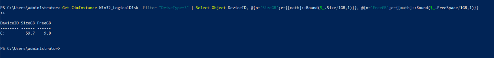
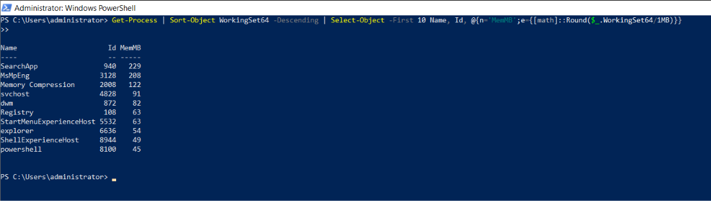
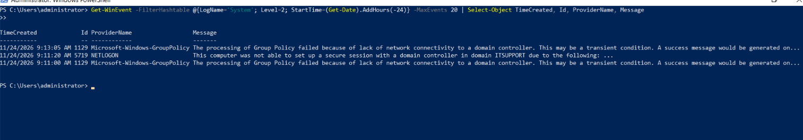
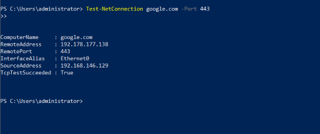
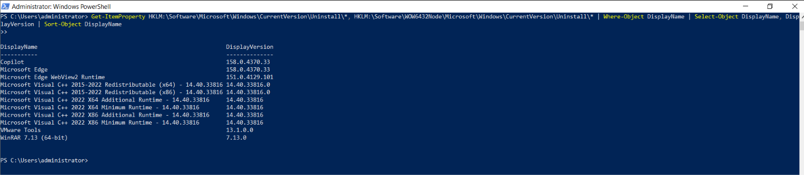

It is 4:45 PM on a Friday. Your manager messages you: *"Can you tell me which laptops are almost out of disk space? Users are complaining that updates keep failing."*

You could remote into each PC and open File Explorer. Or you could run one line, get a table in two seconds, and still make your bus.

That is the real value of PowerShell for support work. You do not need to write long scripts. A good one-liner answers a question, fixes a small problem, or turns a 15-minute manual check into a 10-second one.

These are the ten I reach for most often. Every command here works in Windows PowerShell 5.1, which ships with Windows 10 and 11.

---

## Before you start

| Requirement | Details |
|---|---|
| PowerShell | Windows PowerShell 5.1 (built in) or PowerShell 7 |
| Run as administrator | Needed for service, event log and remoting commands |
| Execution policy | **Not a problem** for one-liners. Execution policy only blocks `.ps1` script files, not commands you type |
| Active Directory commands | Need RSAT (the AD module) and a domain |

> **Tip:** Right-click the Start button and choose **Windows PowerShell (Admin)**. A blue window with `Administrator:` in the title bar means you are elevated.



---

## The 10 one-liners

### 1. How long has this PC been running?

"Have you restarted?" is the most common question in IT. Do not rely on the answer, check it.

```powershell
(Get-Date) - (Get-CimInstance Win32_OperatingSystem).LastBootUpTime
```

If the result shows 30 days, the user has not restarted. Many "weird" problems disappear after a clean reboot.

### 2. How much free disk space is left?

```powershell
Get-CimInstance Win32_LogicalDisk -Filter "DriveType=3" | Select-Object DeviceID, @{n='SizeGB';e={[math]::Round($_.Size/1GB,1)}}, @{n='FreeGB';e={[math]::Round($_.FreeSpace/1GB,1)}}
```

This is the command that answers your manager's Friday question. A drive with very little free space is a top cause of failed updates and slow PCs.



### 3. What is eating the memory?

```powershell
Get-Process | Sort-Object WorkingSet64 -Descending | Select-Object -First 10 Name, Id, @{n='MemMB';e={[math]::Round($_.WorkingSet64/1MB)}}
```

When a user says "my PC is slow", this shows the ten biggest memory users without opening Task Manager. Change `WorkingSet64` to `CPU` to sort by processor time instead.



### 4. Which automatic services are not running?

```powershell
Get-Service | Where-Object { $_.StartType -eq 'Automatic' -and $_.Status -ne 'Running' }
```

Some results are normal, because a few services start and stop on demand. But if you see something like the Print Spooler or Windows Update in this list, you have found a lead.


### 5. Fix a stuck print queue

The classic help desk ticket: *"I cannot print, and the job will not delete."*

```powershell
Stop-Service Spooler -Force; Remove-Item C:\Windows\System32\spool\PRINTERS\* -Force; Start-Service Spooler
```

This stops the spooler, clears the stuck jobs and starts it again. Run it as administrator.

> **Note:** This deletes every waiting print job on that PC. Tell the user first, and test with `-WhatIf` on the `Remove-Item` part if you want to see what would be removed without deleting anything.

### 6. What errors happened in the last 24 hours?

```powershell
Get-WinEvent -FilterHashtable @{LogName='System'; Level=2; StartTime=(Get-Date).AddHours(-24)} -MaxEvents 20 | Select-Object TimeCreated, Id, ProviderName, Message
```

`Level=2` means errors. Swap `System` for `Application` to see application crashes. Instead of scrolling through Event Viewer, you get the newest problems in one view. Look for repeating event IDs, because a repeated error often points to the real cause.



### 7. Is this a network problem or just one site?

```powershell
Test-NetConnection google.com -Port 443
```

Look at `TcpTestSucceeded`. If it says `True`, the network and DNS work and that site is reachable on HTTPS. If it says `False`, test the internet by IP next:

```powershell
Test-NetConnection 8.8.8.8
```

This is the same logic as my four-ping method. If you want the full walkthrough, read [WiFi Connected but No Internet? Find the Broken Link in 4 Pings](/troubleshooting/2026/10/28/wifi-connected-but-no-internet-find-the-broken-link/).



### 8. What software is installed?

```powershell
Get-ItemProperty HKLM:\Software\Microsoft\Windows\CurrentVersion\Uninstall\*, HKLM:\Software\WOW6432Node\Microsoft\Windows\CurrentVersion\Uninstall\* | Where-Object DisplayName | Select-Object DisplayName, DisplayVersion | Sort-Object DisplayName
```

Useful for license checks, finding an old Java version, or confirming that an app was actually installed. Add `| Export-Csv C:\Temp\software.csv -NoTypeInformation` to save the list as a file.

> **Tip:** You will see advice online to use `Get-WmiObject Win32_Product`. Avoid it. It can trigger a repair check on every MSI package, which is slow and can cause side effects.



### 9. Find and unlock a locked-out AD account

This one needs the Active Directory module and a domain.

```powershell
Search-ADAccount -LockedOut | Select-Object Name, SamAccountName
Unlock-ADAccount -Identity jdoe
```

The first line lists everyone who is locked out. The second unlocks a specific user. Always verify the person's identity before you unlock an account, and look into why it locked, because a stale saved password on a phone or mapped drive is a common cause.

### 10. Run a check on many PCs at once

This is where PowerShell becomes automation.

```powershell
Invoke-Command -ComputerName PC01, PC02, PC03 -ScriptBlock { Get-Service Spooler } | Select-Object PSComputerName, Name, Status
```

One command, three computers, one table. You can put any of the earlier one-liners inside the script block, such as disk space, uptime or stopped services.

Requirements:

- Windows Remote Management must be enabled on the target PCs. `Enable-PSRemoting -Force` does it.
- You need admin rights on those PCs.
- On a workgroup (non-domain) network, you may also need to add the targets to TrustedHosts.


---

## Safe habits for running commands on real PCs

PowerShell is powerful, which means mistakes happen fast. Build these habits:

- **Read before you run.** Never paste a command you do not understand into an admin window.
- **Use `-WhatIf`** on anything that changes or deletes: `Remove-Item ... -WhatIf` shows what would happen without doing it.
- **Use `-Confirm`** when you want PowerShell to ask before each change.
- **Test on one PC first,** then roll out to ten, then to a hundred.
- **Read-only first.** `Get-` commands only look. `Set-`, `Remove-`, `Stop-` and `Restart-` change things.
- **Log your work.** Paste the command and result in the ticket notes.

---

## Handy extras

- `Get-Help Get-Service -Examples` shows examples for any command, right in the console.
- `Get-Command *service*` helps you find the right command when you do not remember its name.
- `| Out-GridView` opens results in a window you can filter and sort.
- `| Export-Csv` sends results to a spreadsheet for your manager.

---

## Copy-paste ticket checklist

- [ ] PowerShell opened as administrator
- [ ] Problem described and affected PC identified
- [ ] Read-only checks run first (uptime, disk, services, events)
- [ ] Any change tested with `-WhatIf` or on one PC
- [ ] User informed before clearing queues or restarting services
- [ ] Command and result pasted into the ticket
- [ ] Fix confirmed by the user

---

## Troubleshooting the commands themselves

| Symptom | What to try |
|---|---|
| "Access is denied" | You are not running PowerShell as administrator. Reopen it elevated. |
| `Get-ADUser` or `Search-ADAccount` is not recognized | Install RSAT (Active Directory module) and run it on a domain-joined PC. |
| `Invoke-Command` says WinRM cannot connect | Run `Enable-PSRemoting -Force` on the target, check the firewall and confirm the PC is online. |
| Output is cut off with `...` | Pipe to `Format-List` or `Format-Table -AutoSize -Wrap`. |
| `Stop-Service` cannot find the service | Check the exact name with `Get-Service *spool*`. |
| Event log command returns nothing | There may be no errors in that period, or try a different `LogName` such as `Application`. |

---

## Final thoughts

You do not need to be a programmer to get real value from PowerShell. You need a handful of reliable commands, the habit of checking before changing, and the curiosity to ask, *"Can I get this answer faster?"*

Start with the read-only commands, because they are safe and teach you what normal looks like. Once you trust them, add the fixes. After a few weeks, you will notice that the engineer who automates the boring checks is the one who gets the interesting work.

Next step: pick one ticket type you handle every week and turn it into a one-liner of your own.

---

### Related posts

- [WiFi Connected but No Internet? Find the Broken Link in 4 Pings](/troubleshooting/2026/10/28/wifi-connected-but-no-internet-find-the-broken-link/)
- [Quick Assist: Fix Any Windows PC Without Leaving Your Desk](/remote-support/2026/11/19/quick-assist-fix-any-windows-pc-without-leaving-your-desk/)
- [Active Directory Account Locked Out? Trace the Source in 5 Minutes](/active-directory/2026/11/26/active-directory-account-locked-out-trace-the-source/)
